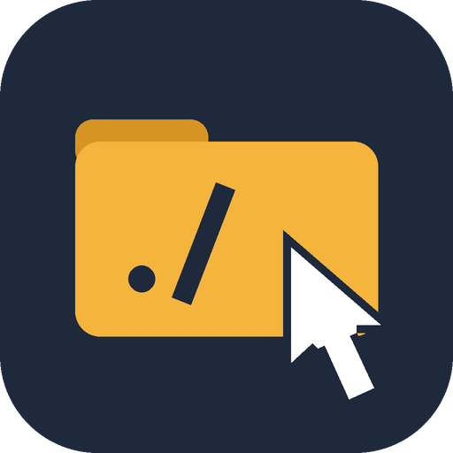

<p align="center"></p>

# clickable-paths

clickable-paths is a Claude Code mod that makes file paths in the transcript clickable. When you click a path, the system file browser opens with that file selected. On Windows the file browser is Explorer, on macOS it is Finder, and on Linux it is the default file manager.

The mod changes only what the transcript shows. The stored messages stay the same, and the model never sees the links.

## Requirements

- Claude Code with mod support (hooks modules). The mod was built and tested on Claude Code 2.1.319. The mod API is in early access, so a later release can change it.
- Windows, macOS or Linux. Windows is tested on a real computer. macOS and Linux are tested only with stand-ins (see [Known limits](#known-limits)).

## Install

At the prompt of a Claude Code terminal session, type:

```
/plugin install clickable-paths --marketplace alazc/clickable-paths-claude-code
```

From a shell:

```
claude plugin install clickable-paths --marketplace alazc/clickable-paths-claude-code
```

Answer `y` to add the marketplace, then select a scope. The mod starts to work at once.

In the desktop app, `/plugin` does not run. Click + next to the prompt box, then Plugins. Add the marketplace `alazc/clickable-paths-claude-code`, then add the plugin.

## What gets linked

| Kind of path | Example |
| --- | --- |
| Windows path, also with spaces | `C:\Users\me\out.png`, `C:\Program Files\app\log.txt` |
| UNC (network share) path | `\\server\share\file.txt` |
| POSIX path | `/home/me/out.png` |
| Git Bash path (shown as a Windows path) | `/c/Users/me/out.png` |
| Relative path with a file extension | `hooks/register.tsx:40`, `.\src\a.ts` |

Relative paths start at the folder where the session started. A `:40` line number stays visible, but the link opens the file, not the line.

If a file or folder does not exist, the mod leaves the path as plain text. Thus web routes such as `/api/users` stay plain. The mod cannot check network paths, so it links UNC paths without a check.

The mod does not change paths inside fenced code blocks, URLs or existing markdown links.

Under each Write, Edit and NotebookEdit tool row, the mod adds a dim "Show in folder" link to the file that the tool changed.

## Use

| Where | Plain click | Ctrl+click |
| --- | --- | --- |
| Fullscreen terminal | The mod shows the file in the file browser. | The terminal opens the file. |
| Desktop app | The mod shows the file in the file browser. | The terminal opens the file. |
| Terminal that is not fullscreen | Nothing (the terminal selects text). | The terminal opens the file. |

When a plain click reaches the mod, a short "Opening" message shows. Then the file browser opens with the file selected. On Windows this takes about half a second.

Claude Code gets mouse clicks only in fullscreen mode. Ctrl+click always goes to the terminal. When the terminal opens a file, it uses the file's default program, the same as a double-click in Explorer.

> [!WARNING]
> Do not ctrl+click a link to a script or program. Examples are `.bat`, `.cmd`, `.ps1`, `.sh` and `.exe` files. The terminal gives the file to the operating system, and the operating system runs it.

To turn the links off or on, type `/clickable-paths`. The change shows at once and stays for later sessions.

If a reply holds a code fence, a table or a GitHub alert, the mod adds the links. Then the other renderers draw the block, for example diagram mods. Links in such a block go to the terminal for every click, as in the table above for ctrl+click.

On the mobile app the mod does nothing. There, a click opens the file browser on your computer, not on the phone.

## What the mod does on your computer

- It checks whether each path in a reply exists. It reads no file contents.
- When you click a link, it starts one program:
  - On Windows, `powershell.exe` runs a fixed script that starts `explorer.exe`. The path goes to the script in an environment variable, as data. It never becomes part of the script text. The script starts Explorer with a normal window, because Claude Code starts programs with a hidden window.
  - On macOS, `open -R`.
  - On Linux, `xdg-open` with the folder of the file.
- It makes no network connections and sends nothing anywhere.

## Known limits

- At the time it draws a reply, the mod checks the disk. If a file appears later, the path stays plain text until the reply draws again.
- If Claude works in another folder than the one where the session started, relative paths point to the wrong place. They then show as plain text, because the file does not exist there.
- A network folder is shown selected in its parent folder, not opened, because the mod cannot check whether a network path is a folder.
- The macOS and Linux code is tested only with stand-ins, not on real computers. Reports are welcome.

## Uninstall

```
/plugin uninstall clickable-paths
```

## Development

Clone the repository, then run the checks in its folder:

```
claude plugin validate .
claude plugin test .
```

To try a change in a session, start Claude Code with the folder as a plugin folder:

```
claude --plugin-dir .
```

Bug reports and pull requests are welcome in the [issues](https://github.com/alazc/clickable-paths-claude-code/issues).

## License

MIT. See [LICENSE](LICENSE).
